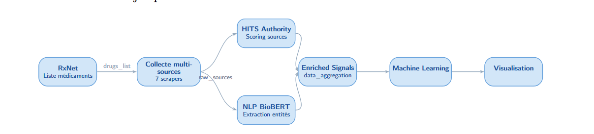

# BioSentry

**Pharmacovigilance platform for the early detection of drug side effects.**

BioSentry gathers data from public medical sources, extracts and normalises the side effects that are
mentioned, aggregates them per *(drug, side effect, period)* triple, and then runs clustering and
anomaly-detection models to surface weak signals and attach an alert level.

> **Team:** Aya Chakour · Amal Afenich · Oumaima Enajjari · Khouloud El Hajji

---

## Architecture



```
 Sources : MedlinePlus · PubMed · ClinicalTrials.gov · openFDA ·
           Drugs.com · WebMD · Reddit
                         |
                         v
        Drug list (RxNorm, by ATC class) ──> drug_list
                         |
                         v
              Scrapers / APIs  (collection)
                         |
                         v
   NLP (BioBERT) + source authority score (HITS, Neo4j)
                         |
                         v
   Normalisation + date extraction ──> normalised_sources
                         |
                         v
             Quality control (quality_flags)
                         |
                         v
 MongoDB Atlas (biosentry_db)
   drug_list -> data_aggregation -> ml_predictions
                         |
                         v
 AI models
   - clustering : K-Means, Agglomerative, HDBSCAN
   - anomalies  : rolling Z-score, Isolation Forest, LOF
                         |
                         v
      Alert level (alerte.py) ──> Dashboard
```

---

## Demo

**Dashboard demonstration (video):**
[▶ Watch the demo video](livrables/Dashboard/2026-05-24%2003-47-16.mp4)

---

## Table of contents

- [Context and problem statement](#context-and-problem-statement)
- [Objectives](#objectives)
- [Repository structure](#repository-structure)
- [Data sources](#data-sources)
- [Data schema](#data-schema)
- [Models](#models)
- [Installation](#installation)
- [Usage](#usage)
- [Dashboard](#dashboard)
- [Deliverables](#deliverables)
- [Limitations and warnings](#limitations-and-warnings)
- [Technologies](#technologies)

---

## Context and problem statement

Clinical trials run before a drug is marketed involve a limited number of patients over a short
period of time: rare or delayed side effects often only appear once the drug is in wide use.
Pharmacovigilance exists to monitor those effects after commercialisation, but the information is
spread across many different sources (official monographs, scientific publications, clinical
trials, adverse-event databases, patient forums) and analysing it manually is slow.

BioSentry brings these sources into a single database, tracks how the mentions of side effects
evolve over time, and automatically flags abnormal behaviour with several complementary
algorithms. The goal is to help raise a signal worth investigating **earlier** — not to replace
the judgement of a healthcare professional.

## Objectives

- Centralise heterogeneous data about drug adverse effects
- Extract and normalise medical entities (drugs, effects, symptoms, dosages) with biomedical NLP
- Weight source reliability with an authority score (HITS)
- Identify groups of similar signals (clustering)
- Detect abnormal mention spikes over time (anomaly detection)
- Produce an actionable alert level: `NORMAL`, `MODEREE`, `ELEVEE`, `CRITIQUE`

## Repository structure

```
.
├── .env.example                     # All credentials / endpoints (copy to .env)
├── .gitignore
├── requirements.txt
├── README.md
└── livrables/
    ├── architecture.png             # Architecture diagram
    ├── Presentation_BioSentry.pdf   # Project presentation
    ├── Rapport_de_projet.pdf        # Project report
    ├── Dashboard/
    │   └── 2026-05-24 03-47-16.mp4  # Dashboard demo video
    ├── collecte_des_données/
    │   ├── 01.Rxnorm/
    │   │   └── rxnorm_builder.py                    # drug_list via the RxNorm API (ATC classes)
    │   ├── 02.Scrapers/
    │   │   ├── biosentry_medlineplus_scraper_full.py # MedlinePlus (Selenium + BeautifulSoup)
    │   │   ├── scraper_pubmed.py                    # PubMed (NCBI E-utilities API)
    │   │   ├── scraper_clinicaltrials.py            # ClinicalTrials.gov (API v2)
    │   │   ├── scraper_openfda.py                   # openFDA (adverse-event reports)
    │   │   ├── scraper_drugscom.py                  # Drugs.com (Selenium)
    │   │   ├── scraper_webmd.py                     # WebMD (Selenium)
    │   │   └── scraper_reddit.py                    # Reddit (patient posts)
    │   ├── 03.NLP/
    │   │   └── nlp_biobert.py                       # BioBERT NER + classifier + VADER sentiment
    │   ├── 04.Hits/
    │   │   └── hits_authority.py                    # HITS authority score for sources (Neo4j)
    │   ├── 05.Normalisation_et_Dates/
    │   │   ├── biosentry_normalisation.py           # Term cleaning and normalisation
    │   │   ├── Date_Extraction.py                   # Date extraction and harmonisation
    │   │   └── merge_normalized_with_dates.py       # Merge normalised data with dates
    │   ├── 06.database_mongodb/                     # Sample JSON exports (no cluster needed)
    │   │   ├── 00.drug_list.json                    # drug list (bootstraps the scrapers)
    │   │   ├── 03_data_entrainement_final.json      # aggregated data (model input)
    │   │   ├── 01_raw_sources.json .json            # not versioned (105 MB, shared separately)
    │   │   └── 02_data_post_nlp_dates.json   .json  # not versioned (22 MB, shared separately)
    │   └── 07.Data_quality/
    │       └── quality_flags.py                     # Data-quality flags
    └── Modèles_ai/
        ├── clustering/
        │   ├── kmeans_clustering.py
        │   ├── agglomeratif.py
        │   ├── hdbscan.py
        │   ├── comparaison_modèle_clustering.py     # 3-model comparison (silhouette, CH, DB)
        │   ├── fusion_final.py                      # Fusion of the 3 clusterings
        │   └── *.json                               # Clustering results
        └── anomalie_detection/
            ├── zscore_rolling.py
            ├── iforest.py
            ├── anomalies_lof.py
            ├── alerte.py                            # Final alert level
            └── *.json                               # Detection results
```

## Data sources

| Source         | Method                              | Content                                             |
| -------------- | ----------------------------------- | --------------------------------------------------- |
| RxNorm         | NLM REST API                        | Drug list per therapeutic class (ATC)               |
| MedlinePlus    | Scraping (Selenium + BeautifulSoup) | Drug monographs, classes, brand names, side effects |
| PubMed         | NCBI E-utilities API                | Articles on adverse effects (2019–2026)             |
| ClinicalTrials | API v2                              | Clinical trials related to adverse effects (2019–2026) |
| openFDA        | API `drug/event`                    | Adverse-event reports (FAERS)                       |
| Drugs.com      | Scraping (Selenium)                 | Reviews and reported side effects                   |
| WebMD          | Scraping (Selenium)                 | Reviews and reported side effects                   |
| Reddit         | HTTP requests on targeted subreddits| Patient testimonials                                |

> **Warning:** MedlinePlus monographs are copyrighted (ASHP). Their use in this project is strictly
> limited to academic research. The terms of use of every scraped site must be respected.

## Data schema

### Raw MedlinePlus document (one document per drug)

```json
{
  "url": "https://medlineplus.gov/druginfo/meds/a606008.html",
  "drug_name": "Phenylephrine",
  "drug_class": "nasal decongestants",
  "brand_names": ["Lusonal", "Sudafed PE Congestion"],
  "prescribed_for": ["Phenylephrine is used to relieve nasal discomfort ..."],
  "side_effects": {
    "mild": [],
    "serious": ["nervousness", "dizziness", "sleeplessness"],
    "total": 3
  },
  "warnings": [],
  "source": "MedlinePlus",
  "scraped_at": "2026-05-16 18:37:18"
}
```

| Field                 | Type           | Description                                  |
| --------------------- | -------------- | -------------------------------------------- |
| `url`                 | text           | Source MedlinePlus page                      |
| `drug_name`           | text           | Drug name                                    |
| `drug_class`          | text           | Therapeutic class                            |
| `brand_names`         | list of text   | Brand names                                  |
| `prescribed_for`      | list of text   | Indications                                  |
| `side_effects.mild`   | list of text   | Mild side effects                            |
| `side_effects.serious`| list of text   | Serious side effects                         |
| `side_effects.total`  | integer        | Total number of side effects                 |
| `warnings`            | list of text   | Warnings                                     |
| `source`              | text           | Origin of the data                           |
| `scraped_at`          | text           | Collection date and time                     |

### MongoDB collections (`biosentry_db`)

| Collection           | Main fields                                                        | Role                                                                |
| -------------------- | ------------------------------------------------------------------ | ------------------------------------------------------------------- |
| `drug_list`          | `name`, `category`                                                 | Drugs to query (PubMed, ClinicalTrials, …)                          |
| `normalised_sources` | normalised text, extracted entities, dates, authority score        | Cleaned data coming from every source                               |
| `data_aggregation`   | `drug`, `side_effect`, `period` (YYYY-MM), `mention_count`         | Mention counts per drug/effect/month — model input                  |
| `ml_predictions`     | `drug`, `side_effect`, `period`, `lof_anomaly`, `iforest_anomaly`, `zscore_anomaly`, `nb_algos`, `alert_level` | Detector outputs and final alert level |

## Models

### NLP pre-processing

- Entity extraction (drugs, side effects, symptoms, dosages) with a **BioBERT** model, completed by
  a classifier and a **VADER** sentiment analysis.
- Source authority score computed with the **HITS** algorithm (graph stored in **Neo4j**) to weight
  the reliability of each source.
- Term normalisation and date extraction (period 2019–2026), then a quality-control pass
  (`quality_flags.py`).

### Clustering

Applied to the aggregated data (`data_aggregation`) with standardised variables (`StandardScaler`):

- **K-Means**
- **Agglomerative** clustering
- **HDBSCAN** — separates signal clusters, outlier points (critical flags in pharmacovigilance) and noise

`comparaison_modèle_clustering.py` compares the models with the silhouette, Calinski-Harabasz and
Davies-Bouldin metrics (PCA visualisation). `fusion_final.py` merges the three results into
`combined_clusters.json`.

### Anomaly detection

Features used: mention count, mean, standard deviation, total mentions, number of periods, month.

- **Rolling Z-score** (window adapted to the length of each series)
- **Isolation Forest**
- **Local Outlier Factor (LOF)**

### Alert level

`alerte.py` counts how many algorithms flag an anomaly for the same
*(drug, side effect, period)* triplet:

| Algorithms in alert | Level     |
| ------------------- | --------- |
| 3                   | `CRITIQUE`|
| 2                   | `ELEVEE`  |
| 1                   | `MODEREE` |
| 0                   | `NORMAL`  |

## Installation

**Prerequisites:** Python 3.10+, a MongoDB cluster (Atlas or local), Google Chrome (Selenium
scrapers) and a local Neo4j instance (only for the HITS computation).

```bash
git clone https://github.com/amalafenich/biosentry.git
cd biosentry
python -m venv .venv
source .venv/bin/activate        # Windows: .venv\Scripts\activate
pip install -r requirements.txt
python -m spacy download en_core_web_sm   # spaCy model used by the normalisation step
```

**Configuration** — every credential and endpoint lives in the environment, never in the code:

```bash
cp .env.example .env
```

Then fill in `.env`:

| Variable            | Purpose                                            |
| ------------------- | -------------------------------------------------- |
| `MONGO_URI`         | MongoDB connection string (required everywhere)    |
| `NCBI_API_KEY`      | NCBI/PubMed API key (optional, higher rate limit)  |
| `NCBI_EMAIL`        | Contact email sent with NCBI requests              |
| `OPENFDA_API_KEY`   | openFDA key (optional, higher rate limit)          |
| `NEO4J_URI`         | Neo4j URI for the HITS score                       |
| `NEO4J_USER`        | Neo4j user                                         |
| `NEO4J_PASSWORD`    | Neo4j password                                     |
| `ES_HOST`           | Elasticsearch URL (optional, HITS index)           |
| `ES_INDEX`          | Elasticsearch index name                           |
| `CONTACT_EMAIL`     | Contact address in the MedlinePlus user-agent      |

The `.env` file is excluded by `.gitignore` — **never commit it**.

## Usage

Recommended execution order:

```bash
# 1. Drug list (creates the drug_list collection)
python "livrables/collecte_des_données/01.Rxnorm/rxnorm_builder.py"

# 2. Collection
python "livrables/collecte_des_données/02.Scrapers/biosentry_medlineplus_scraper_full.py"
python "livrables/collecte_des_données/02.Scrapers/scraper_pubmed.py"
python "livrables/collecte_des_données/02.Scrapers/scraper_clinicaltrials.py"
python "livrables/collecte_des_données/02.Scrapers/scraper_openfda.py"
python "livrables/collecte_des_données/02.Scrapers/scraper_drugscom.py"
python "livrables/collecte_des_données/02.Scrapers/scraper_webmd.py"
python "livrables/collecte_des_données/02.Scrapers/scraper_reddit.py"

# 3. NLP, source authority, normalisation and dates
#    (biosentry_normalisation.py imports nlp_biobert and hits_authority:
#     the three modules must be reachable from the PYTHONPATH)
python "livrables/collecte_des_données/05.Normalisation_et_Dates/biosentry_normalisation.py"
python "livrables/collecte_des_données/05.Normalisation_et_Dates/Date_Extraction.py"
python "livrables/collecte_des_données/05.Normalisation_et_Dates/merge_normalized_with_dates.py"

# 4. Quality control
python "livrables/collecte_des_données/07.Data_quality/quality_flags.py"

# 5. Clustering (run from the model folder)
cd "livrables/Modèles_ai/clustering"
python kmeans_clustering.py
python agglomeratif.py
python hdbscan.py
python "comparaison_modèle_clustering.py"
python fusion_final.py
cd ../../..

# 6. Anomaly detection
cd "livrables/Modèles_ai/anomalie_detection"
python zscore_rolling.py
python iforest.py
python anomalies_lof.py
python alerte.py
```

**Remarks:**

- The scrapers read the drug list from the `drug_list` collection, which must exist before they run.
- The model scripts read the `data_aggregation` collection; `alerte.py` reads `ml_predictions`.
- `fusion_final.py` expects a file named `agglo_results.json`: rename `agglomeratif_results.json`
  if necessary.
- The JSON files in `livrables/collecte_des_données/06.database_mongodb/` let you inspect the data
  without re-running the whole collection pipeline: `00.drug_list.json` and
  `03_data_entrainement_final.json` are versioned, while the heavy raw/intermediate exports
  (`01_raw_sources…`, `02_data_post_nlp_dates…`, 105 MB and 22 MB) are **not** committed — they are
  shared separately as an archive.
- The dashboard demo video is stored with **Git LFS** (`git lfs track "livrables/Dashboard/*.mp4"`),
  since it is larger than GitHub's 100 MB file limit.

## Dashboard

A video demonstration of the dashboard is available here:
**[Watch the demo video](livrables/Dashboard/2026-05-24%2003-47-16.mp4)**

## Deliverables

- Project presentation: `livrables/Presentation_BioSentry.pdf`
- Project report: `livrables/Rapport_de_projet.pdf`
- Collection, processing and modelling code
- Collected data and model results as JSON
- Dashboard demo video (link above)

## Limitations and warnings

- BioSentry is a **research/academic** tool: it highlights signals to investigate, it does not
  establish causality and must not be used as medical advice.
- Mention counts reflect what is published and reported, not real incidence rates (reporting bias).
- Scraped content depends on the availability and terms of use of each source.
- MedlinePlus monographs are copyrighted (ASHP) and restricted to academic use.

## Technologies

Python, pandas, NumPy, scikit-learn, HDBSCAN, PyMongo, Neo4j, Elasticsearch, Selenium,
BeautifulSoup, requests, lxml, spaCy, PyTorch, Hugging Face Transformers (BioBERT), VADER,
python-dotenv, tqdm.
