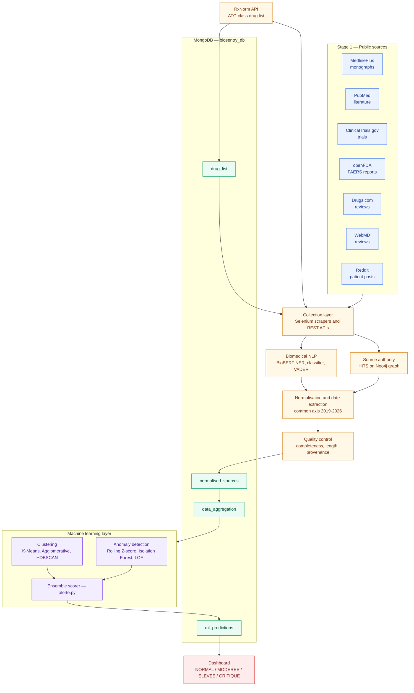
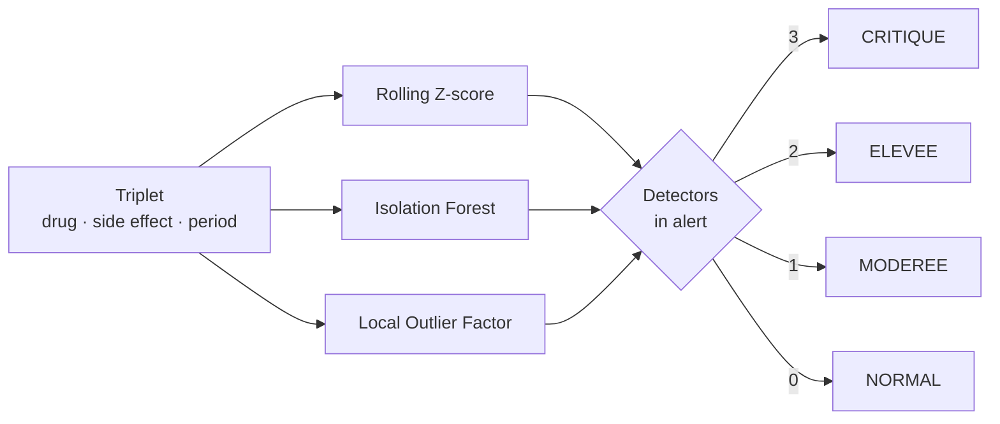

# BioSentry

**Turn scattered public health data into an early drug-safety signal.**


BioSentry is a pharmacovigilance platform that monitors public medical sources for mentions of drug
side effects, measures how those mentions evolve month after month, and raises a graded alert when a
*(drug, side effect, period)* combination behaves abnormally. It combines biomedical NLP, source
credibility scoring and an ensemble of unsupervised models to surface **weak signals worth
investigating** — earlier than manual surveillance would.

**Team:** Aya Chakour · Amal Afenich · Oumaima Enajjari · Khouloud El Hajji

---

## Contents

- [Why BioSentry](#why-biosentry)
- [Features](#features)
- [Architecture](#architecture)
- [Demo](#demo)
- [Pipeline](#pipeline)
- [Machine learning](#machine-learning)
- [Data sources](#data-sources)
- [Data model](#data-model)
- [Repository layout](#repository-layout)
- [Getting started](#getting-started)
- [Running the pipeline](#running-the-pipeline)
- [Outputs](#outputs)
- [Responsible use and limitations](#responsible-use-and-limitations)
- [Deliverables](#deliverables)
- [Tech stack](#tech-stack)

---

## Why BioSentry

Pre-market clinical trials are intentionally small and short: they can only detect common, early
adverse reactions. Rare or delayed effects emerge later, once a drug is prescribed at scale — and
post-market surveillance has to piece together evidence that is scattered across official
monographs, literature databases, trial registries, regulatory reports, commercial sites and
patient communities.

Manual review of those sources does not scale. BioSentry replaces the manual pass with an
auditable pipeline:

| Stage          | Manual approach                     | BioSentry                                          |
| -------------- | ----------------------------------- | -------------------------------------------------- |
| Collection     | One source at a time, by hand       | 7 sources collected automatically                  |
| Normalisation  | Inconsistent terminology            | Unified medical vocabulary and time axis           |
| Credibility    | Assumed equal                       | Quantified per source (HITS authority score)       |
| Detection      | Eyeballing spreadsheets             | 6 unsupervised models in ensemble                  |
| Triage         | Subjective priority                 | Explicit levels: `NORMAL` → `CRITIQUE`             |

> **Objective:** accelerate the moment a safety signal becomes visible, while keeping a human expert
> in the loop. BioSentry is a decision-support tool, never a substitute for clinical judgement.

## Features

- **Unified ingestion** — REST APIs and Selenium scrapers feeding a single MongoDB database.
- **Biomedical NLP** — BioBERT-based entity recognition (drug, side effect, symptom, dosage),
  classification and VADER sentiment analysis.
- **Source credibility** — HITS authority scoring over a citation graph stored in Neo4j, so a mention
  from a peer-reviewed source does not weigh the same as an anonymous forum post.
- **Temporal normalisation** — every mention is mapped onto a common `(drug, side_effect, YYYY-MM)`
  axis covering 2019–2026.
- **Quality control** — completeness, text-length and provenance flags attached to each document.
- **Signal discovery** — three clustering algorithms to group comparable signals, three anomaly
  detectors to spot abnormal mention spikes.
- **Graded alerting** — an ensemble rule converts detector votes into `NORMAL`, `MODEREE`, `ELEVEE`
  or `CRITIQUE`.
- **Reproducible** — everything is driven by scripts and configuration; no credentials in code.

## Architecture



| Layer          | Components                                                | Responsibility                                     |
| -------------- | --------------------------------------------------------- | -------------------------------------------------- |
| Sources        | MedlinePlus, PubMed, ClinicalTrials, openFDA, Drugs.com, WebMD, Reddit | Raw evidence about adverse effects                 |
| Vocabulary     | RxNorm                                                    | Defines *which* drugs are monitored (ATC classes)  |
| Collection     | `01.Rxnorm`, `02.Scrapers`                                | Retrieval, throttling, upsert into MongoDB         |
| Understanding  | `03.NLP`, `04.Hits`, `05.Normalisation_et_Dates`, `07.Data_quality` | Entities, credibility, dates, quality flags        |
| Storage        | MongoDB `biosentry_db`                                    | `drug_list` → `normalised_sources` → `data_aggregation` → `ml_predictions` |
| Modelling      | `Modèles_ai/clustering`, `Modèles_ai/anomalie_detection`  | Groups signals, flags anomalies, assigns alert     |
| Consumption    | Dashboard                                                 | Prioritised list of signals under investigation    |

## Demo

**Walkthrough of the dashboard:**
[▶ Watch the demo video](livrables/Dashboard/2026-05-24%2003-47-16.mp4)

## Pipeline

| # | Phase            | Entry point                                                        | Writes to               |
| - | ---------------- | ------------------------------------------------------------------ | ----------------------- |
| 1 | Drug dictionary  | `collecte_des_données/01.Rxnorm/rxnorm_builder.py`                 | `drug_list`             |
| 2 | Collection       | `collecte_des_données/02.Scrapers/*.py`                            | raw source collections  |
| 3 | NLP              | `collecte_des_données/03.NLP/nlp_biobert.py`                       | enriched documents      |
| 4 | Source authority | `collecte_des_données/04.Hits/hits_authority.py`                    | authority scores        |
| 5 | Normalisation    | `collecte_des_données/05.Normalisation_et_Dates/*.py`               | `normalised_sources`    |
| 6 | Quality control  | `collecte_des_données/07.Data_quality/quality_flags.py`             | quality flags           |
| 7 | Aggregation      | (produced during normalisation)                                    | `data_aggregation`      |
| 8 | Clustering       | `Modèles_ai/clustering/*.py`                                       | cluster labels (JSON)   |
| 9 | Anomaly detection| `Modèles_ai/anomalie_detection/*.py`                               | `ml_predictions`        |
| 10| Alerting         | `Modèles_ai/anomalie_detection/alerte.py`                          | `alert_level`           |

## Machine learning

### Input

Every model reads `data_aggregation`, one row per *(drug, side effect, period)* with
`mention_count`. Features are standardised with `StandardScaler` before modelling.

### Clustering — grouping comparable signals

| Algorithm        | Role                                                                 |
| ---------------- | -------------------------------------------------------------------- |
| K-Means          | Fast baseline partition of the signal space                          |
| Agglomerative    | Hierarchical structure, no need to preset *k* a priori               |
| HDBSCAN          | Density-based: isolates signal clusters, outliers and noise — the outlier group acts as a critical-flag candidate list |

The three are benchmarked with silhouette, Calinski-Harabasz and Davies-Bouldin scores
(`comparaison_modèle_clustering.py`, PCA visualisation) and merged into `combined_clusters.json`
by `fusion_final.py`.

### Anomaly detection — spotting abnormal spikes

| Detector          | Principle                                                          |
| ----------------- | ------------------------------------------------------------------ |
| Rolling Z-score   | Deviation from a moving baseline, window adapted to series length  |
| Isolation Forest  | Isolates observations that are easy to separate from the majority  |
| LOF               | Local density deviation against neighbouring points                |

### Ensemble alerting



| Detectors agreeing | Alert level |
| ------------------ | ----------- |
| 3                  | `CRITIQUE`  |
| 2                  | `ELEVEE`    |
| 1                  | `MODEREE`   |
| 0                  | `NORMAL`    |

Agreement between independent algorithms is the confidence proxy: one vote is a lead, three votes
are a priority.

## Data sources

| Source          | Access method                         | Extracted content                              |
| --------------- | ------------------------------------- | ---------------------------------------------- |
| RxNorm (NLM)    | REST API                              | Drug list per ATC class                        |
| MedlinePlus     | Selenium + BeautifulSoup              | Monographs, classes, brand names, side effects |
| PubMed          | NCBI E-utilities                      | Literature on adverse effects, 2019–2026       |
| ClinicalTrials  | API v2                                | Trials involving adverse effects, 2019–2026    |
| openFDA         | `drug/event` API                      | FAERS adverse-event reports                    |
| Drugs.com       | Selenium                              | Consumer reviews and side-effect reports       |
| WebMD           | Selenium                              | Consumer reviews and side-effect reports       |
| Reddit          | HTTP over targeted subreddits         | Patient testimony                              |

> **Legal note:** MedlinePlus monographs are copyrighted (ASHP) and used here strictly for academic
> research. The terms of every scraped site must be respected — rate limits, robots rules and
> attribution included.

## Data model

### Raw MedlinePlus document

```json
{
  "url": "https://medlineplus.gov/druginfo/meds/a606008.html",
  "drug_name": "Phenylephrine",
  "drug_class": "nasal decongestants",
  "brand_names": ["Lusonal", "Sudafed PE Congestion"],
  "prescribed_for": ["Phenylephrine is used to relieve nasal discomfort ..."],
  "side_effects": {
    "mild": [],
    "serious": ["nervousness", "dizziness", "sleeplessness"],
    "total": 3
  },
  "warnings": [],
  "source": "MedlinePlus",
  "scraped_at": "2026-05-16 18:37:18"
}
```

### MongoDB collections — `biosentry_db`

| Collection           | Key fields                                                                     | Purpose                                          |
| -------------------- | ------------------------------------------------------------------------------ | ------------------------------------------------ |
| `drug_list`          | `name`, `category`                                                             | Scope of surveillance (drugs to query)           |
| `normalised_sources` | `text_clean`, `side_effects`, `year_month`, `authority_score`, `source`         | Cleaned, dated, credibility-weighted mentions    |
| `data_aggregation`   | `drug`, `side_effect`, `period`, `mention_count`                               | Model input: mention counts per month            |
| `ml_predictions`     | `lof_anomaly`, `iforest_anomaly`, `zscore_anomaly`, `nb_algos`, `alert_level`  | Detector outputs and final alert                 |

## Repository layout

```
.
├── .env.example                      # All credentials and endpoints (copy to .env)
├── .gitignore
├── .gitattributes                    # Git LFS rule for the demo video
├── requirements.txt
├── README.md
└── livrables/
    ├── architecture.png              # Architecture diagram (static export)
    ├── Presentation_BioSentry.pdf    # Project presentation
    ├── Rapport_de_projet.pdf         # Project report
    ├── Dashboard/
    │   └── 2026-05-24 03-47-16.mp4   # Dashboard demo (Git LFS)
    ├── collecte_des_données/
    │   ├── 01.Rxnorm/rxnorm_builder.py
    │   ├── 02.Scrapers/              # 7 collectors (API + Selenium)
    │   ├── 03.NLP/nlp_biobert.py
    │   ├── 04.Hits/hits_authority.py
    │   ├── 05.Normalisation_et_Dates/
    │   ├── 06.database_mongodb/      # Sample JSON exports
    │   └── 07.Data_quality/quality_flags.py
    └── Modèles_ai/
        ├── clustering/               # K-Means, agglomerative, HDBSCAN, comparison, fusion
        └── anomalie_detection/       # Z-score, iForest, LOF, alerte.py
```

## Getting started

**Prerequisites:** Python 3.10+, a MongoDB cluster (Atlas or local), Google Chrome for the Selenium
scrapers, a local Neo4j instance for the HITS score (Elasticsearch optional), and
[Git LFS](https://git-lfs.com) to clone the demo video.

```bash
git clone https://github.com/Ayaa-ch/Biosentry-project.git
cd Biosentry-project
git lfs pull

python -m venv .venv
source .venv/bin/activate          # Windows: .venv\Scripts\activate
pip install -r requirements.txt
python -m spacy download en_core_web_sm
```

### Configuration

Secrets never live in the code — copy the template and fill it in:

```bash
cp .env.example .env
```

| Variable           | Required | Purpose                                        |
| ------------------ | -------- | ---------------------------------------------- |
| `MONGO_URI`        | yes      | MongoDB connection string                      |
| `NCBI_API_KEY`     | no       | Higher NCBI/PubMed rate limit                  |
| `NCBI_EMAIL`       | recomm.  | Contact address sent with NCBI requests        |
| `OPENFDA_API_KEY`  | no       | Higher openFDA rate limit                      |
| `NEO4J_URI`        | for HITS | Neo4j bolt URI                                 |
| `NEO4J_USER`       | for HITS | Neo4j user                                     |
| `NEO4J_PASSWORD`   | for HITS | Neo4j password                                 |
| `ES_HOST`          | no       | Elasticsearch URL (HITS index)                 |
| `ES_INDEX`         | no       | Elasticsearch index name                       |
| `CONTACT_EMAIL`    | no       | Contact in the MedlinePlus user-agent          |

`.env` is covered by `.gitignore` — **never commit it**.

## Running the pipeline

Run the phases in order; each one depends on the collection written by the previous one.

```bash
# 1 — drug dictionary
python "livrables/collecte_des_données/01.Rxnorm/rxnorm_builder.py"

# 2 — collection
python "livrables/collecte_des_données/02.Scrapers/biosentry_medlineplus_scraper_full.py"
python "livrables/collecte_des_données/02.Scrapers/scraper_pubmed.py"
python "livrables/collecte_des_données/02.Scrapers/scraper_clinicaltrials.py"
python "livrables/collecte_des_données/02.Scrapers/scraper_openfda.py"
python "livrables/collecte_des_données/02.Scrapers/scraper_drugscom.py"
python "livrables/collecte_des_données/02.Scrapers/scraper_webmd.py"
python "livrables/collecte_des_données/02.Scrapers/scraper_reddit.py"

# 3 — NLP, source authority, normalisation, dates
#     (biosentry_normalisation.py imports nlp_biobert and hits_authority:
#      the three modules must be importable from the PYTHONPATH)
python "livrables/collecte_des_données/05.Normalisation_et_Dates/biosentry_normalisation.py"
python "livrables/collecte_des_données/05.Normalisation_et_Dates/Date_Extraction.py"
python "livrables/collecte_des_données/05.Normalisation_et_Dates/merge_normalized_with_dates.py"

# 4 — quality control
python "livrables/collecte_des_données/07.Data_quality/quality_flags.py"

# 5 — clustering (run from the model folder)
cd "livrables/Modèles_ai/clustering"
python kmeans_clustering.py
python agglomeratif.py
python hdbscan.py
python "comparaison_modèle_clustering.py"
python fusion_final.py
cd ../../..

# 6 — anomaly detection and alerting
cd "livrables/Modèles_ai/anomalie_detection"
python zscore_rolling.py
python iforest.py
python anomalies_lof.py
python alerte.py
```

**Notes**

- The scrapers read `drug_list`; build it before collecting.
- Clustering and anomaly scripts read `data_aggregation`; `alerte.py` reads `ml_predictions`.
- `fusion_final.py` expects `agglo_results.json` — rename `agglomeratif_results.json` first.
- Skipping the heavy collection is possible: `06.database_mongodb/` ships `00.drug_list.json` and
  `03_data_entrainement_final.json` (the large raw exports are distributed separately as an
  archive, they are not versioned).

## Outputs

- `ml_predictions` — one document per triplet with the three detector flags, the number of
  agreeing algorithms and the final `alert_level`.
- `combined_clusters.json` — fused cluster membership for the three clustering models.
- Per-model JSON exports (`*_results.json`, `*_anomalies.json`) next to each script, for
  inspection and reporting.
- Dashboard — prioritised, filterable view of the signals by alert level.

## Responsible use and limitations

- **Not medical advice.** BioSentry highlights patterns to investigate; it establishes no causal
  link between a drug and an adverse event.
- **Reporting bias.** Mention counts reflect what is published and reported, not real incidence —
  spikes may follow media attention rather than a safety problem.
- **Human review required.** Every `CRITIQUE` signal must be assessed by a qualified
  pharmacovigilance professional before any action.
- **Source terms apply.** Scraping is restricted to academic use; MedlinePlus content is
  copyrighted (ASHP).

## Deliverables

| Artifact                          | Path                                              |
| --------------------------------- | ------------------------------------------------- |
| Architecture diagram              | `livrables/architecture.png`                      |
| Project presentation              | `livrables/Presentation_BioSentry.pdf`            |
| Project report                    | `livrables/Rapport_de_projet.pdf`                 |
| Pipeline code                     | `livrables/collecte_des_données/`                 |
| Models and results                | `livrables/Modèles_ai/`                           |
| Dashboard demo video              | `livrables/Dashboard/` (Git LFS)                  |
| Sample data exports               | `livrables/collecte_des_données/06.database_mongodb/` |

## Tech stack

| Layer            | Technologies                                                                 |
| ---------------- | ---------------------------------------------------------------------------- |
| Data             | pandas, NumPy, PyMongo, requests, lxml                                       |
| Scraping         | Selenium, webdriver-manager, BeautifulSoup, tqdm                             |
| NLP              | PyTorch, Hugging Face Transformers (BioBERT), spaCy, VADER                   |
| Graph / search   | Neo4j, Elasticsearch                                                         |
| Machine learning | scikit-learn, HDBSCAN                                                        |
| Settings         | python-dotenv (`.env` — never committed)                                     |

---

*BioSentry is an academic project. Use it for research and education only.*
